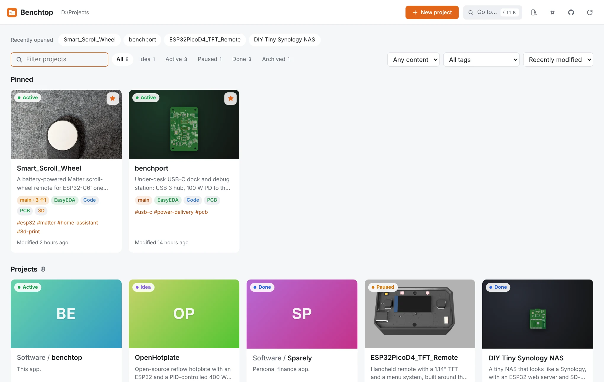
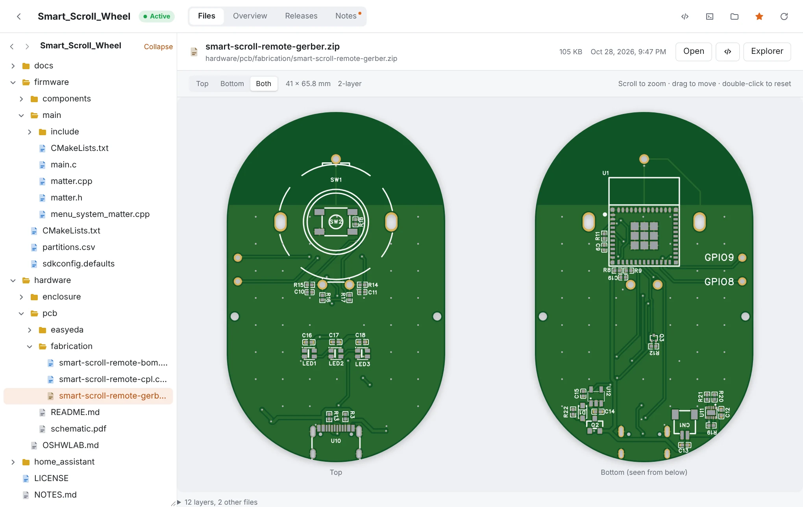
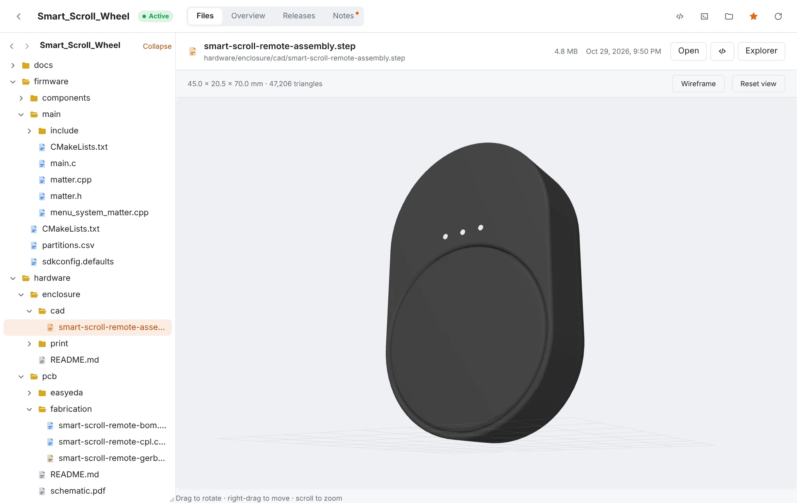
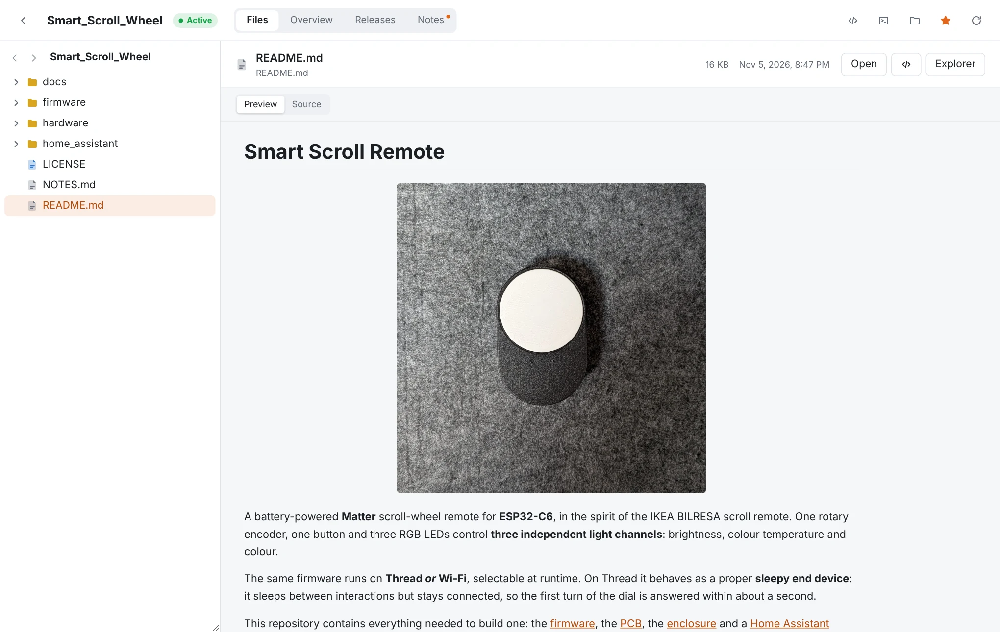
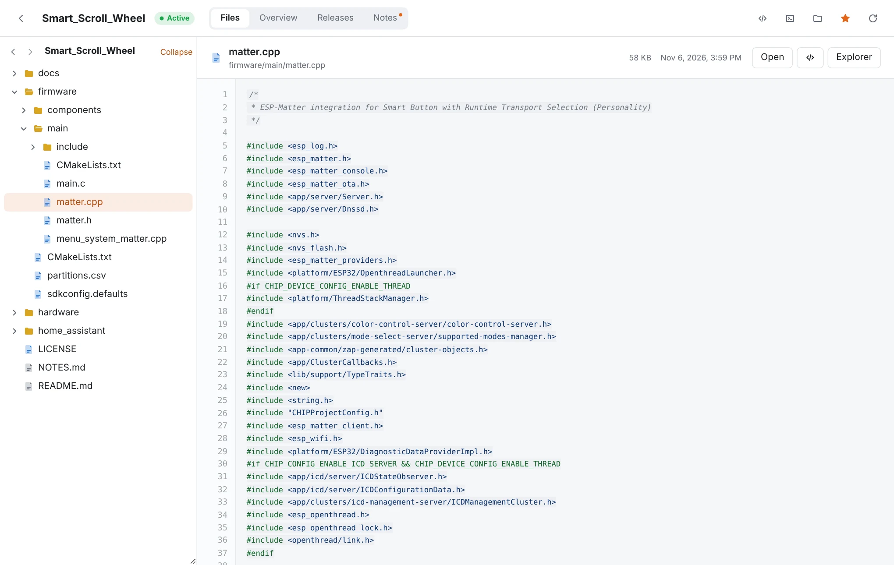
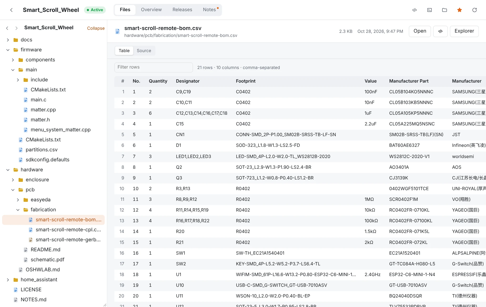
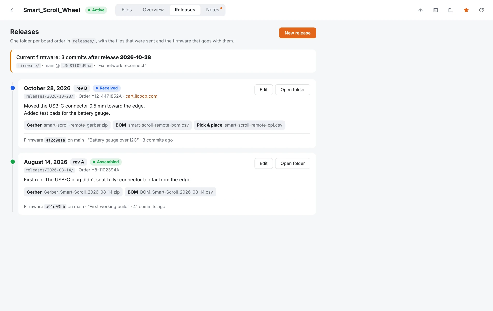
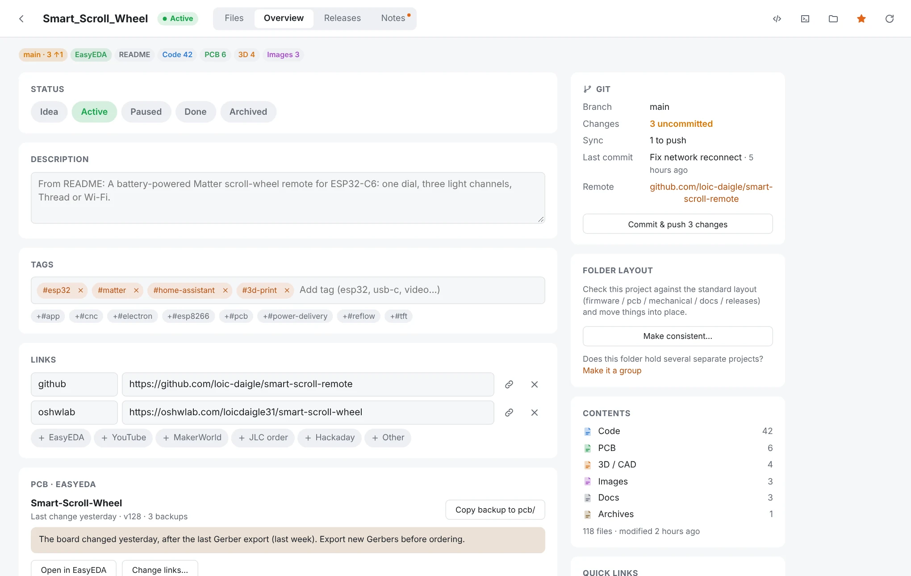
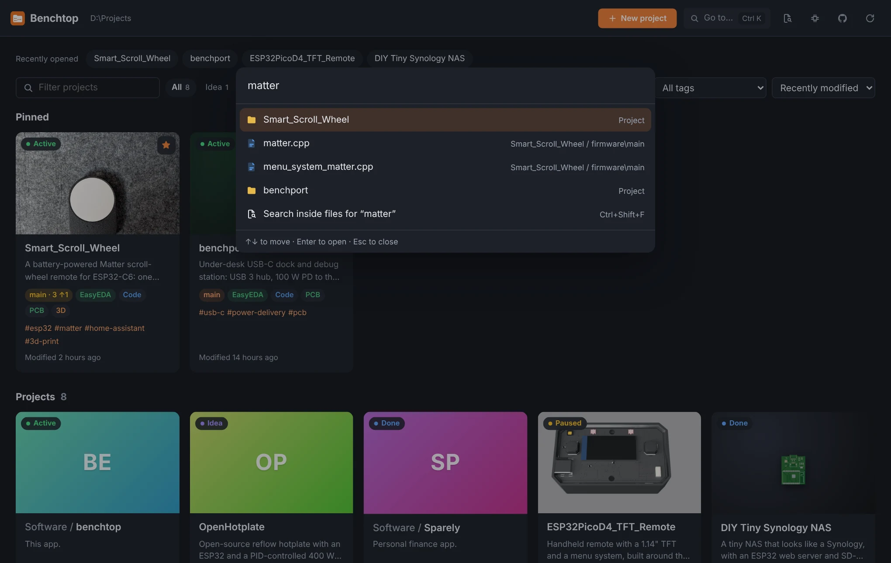
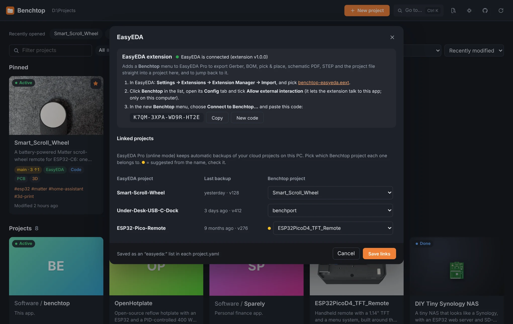

# Benchtop

A Windows desktop app for makers: all your hardware and firmware projects in one place, with the code, the PCB, the 3D
models and the docs side by side. It works on a plain folder of projects, so nothing needs to be imported.

<p align="center">
  <picture>
    <source media="(prefers-color-scheme: dark)" srcset="docs/screenshots/dashboard-dark.webp">
    
  </picture>
</p>

## See your boards and parts without opening a CAD tool

| Gerber viewer | 3D viewer (STEP, STL, 3MF, OBJ) |
|:---:|:---:|
|  |  |
| Any Gerber zip (EasyEDA, KiCad, JLC plugin…): top and bottom, zoom and pan, board size and layer count. | STEP files are read with OpenCascade, colours included. Rotate, zoom, wireframe, size in mm. |

| README, Markdown and PDF | Code | BOM and CSV |
|:---:|:---:|:---:|
|  |  |  |

## Track every board you order



**Releases** keeps one folder per order (`releases/<date>/`) with the Gerber, BOM and pick & place that were sent, the board
revision, order number, notes, and the firmware commit that goes with it. Benchtop tells you which release your current
firmware matches ("3 commits after rev B").

## Everything about a project on one page



## Features

- **Dashboard**: a card per project with a cover image, description, status, tags, Git state and what it contains
  (Code / PCB / 3D). Filter by status, tag or content; pins and recently opened on top. Folders like `Software/` that hold
  several projects show each one.
- **Project page**: Files (tree + previews), Overview, Releases and Notes (`NOTES.md` with tickable to-dos).
- **Previews**: images, Markdown with HTML (GitHub-style), PDF, code with syntax colours, CSV / BOM tables, Gerber zips,
  STEP / IGES / STL / 3MF / OBJ, and the file list of any other zip.
- **Ctrl+K** to jump to any project or file, **Ctrl+Shift+F** to search inside files across all projects.
- **EasyEDA Pro**: link each project to its EasyEDA project, get warned when the board changed after your last Gerber export,
  copy EasyEDA's automatic backups into the project. A companion **EasyEDA extension** exports Gerber, BOM, pick & place,
  schematic PDF, STEP and the project file straight into the right folder.
- **GitHub**: publish a project as a new repo in one click (checks for Wi-Fi passwords and API keys first, uses Git LFS for
  CAD files), then commit & push or pull from the app.
- **New project** with a standard folder layout, and **Make consistent** to tidy an existing one (moves only, with undo).
- Open in **VS Code**, **terminal** or **Explorer** in one click. Follows the Windows light/dark setting. Updates itself.

| Ctrl+K | EasyEDA |
|:---:|:---:|
|  |  |

### What Benchtop writes

Your projects stay plain folders. Benchtop only writes when you ask it to:

- `project.yaml`: project info (status, description, tags, links, cover, linked EasyEDA projects). Comments and extra keys
  you add by hand are kept. Kept out of git (local only).
- `NOTES.md`: project notes.
- `releases/<name>/release.yaml`: release info (local only, never pushed), and the files you choose to copy into a release.
- Files you export from EasyEDA, folders and moves you confirm in **New project** / **Make consistent**, and git commits you
  make from the app.

App settings (pins, recent, cache, GitHub sign-in) live in Benchtop's own app-data folder.

```yaml
# project.yaml example
status: active          # idea | active | paused | done | archived
description: Matter scroll-wheel remote for ESP32-C6
tags: [esp32, matter, video]
cover: docs/media/smart-scroll-remote.jpg
links:
  github: https://github.com/loic-daigle/smart-scroll-remote
  youtube: https://youtu.be/...
```

Shortcuts: `Ctrl+K` go to · `Ctrl+Shift+F` search in files · `Esc` back to dashboard · `Alt+←/→` file history.

## Run it

Requirements: [Node.js](https://nodejs.org) 20 or newer. [Git](https://git-scm.com) for the Git panel (optional).

```powershell
cd "C:\Users\loic\Desktop\Projets\Software\benchtop"
npm install
npm start
```

On first launch it uses `Desktop\Projets` automatically. Click the folder path in the top bar to pick another one.

## Install it as an app

```powershell
npm run make
```

This builds `out\make\squirrel.windows\x64\Benchtop-Setup.exe` (a few minutes the first time). Run it: Benchtop installs for your
Windows user (no admin), opens, and adds itself to the Start menu and the desktop. Uninstall it from Windows Settings → Apps.

- Settings, pins, the EasyEDA pairing code and the GitHub sign-in are shared with `npm start` (same `%APPDATA%\Benchtop` folder).
- Only one Benchtop runs at a time; launching it again brings the open window forward. Close the `npm start` one first.
- The EasyEDA extension (`benchtop-easyeda.eext`) is included: Benchtop → EasyEDA window → click its name to find it.
- The installed app updates itself from this repo's GitHub releases (see below). Your settings stay.

## Publish a new version (auto-update)

Installed copies check [update.electronjs.org](https://update.electronjs.org) at start and every hour. It reads the public
releases of `loic-daigle/benchtop`; a newer version is downloaded in the background and Benchtop offers to restart.

1. Bump `version` in `package.json` (e.g. `1.0.0` → `1.0.1`). Same version = no update.
2. Commit and push.
3. `npm run publish` — builds the installer and uploads it as a GitHub release `v1.0.1`.
   It needs a token that can create releases: the GitHub CLI's login (`gh auth login`), or `$env:GITHUB_TOKEN = "ghp_…"`.

The first install still comes from `Benchtop-Setup.exe` (from `npm run make` or the release page). The app isn't code-signed, so
Windows SmartScreen asks once: *More info → Run anyway*. Updates after that install silently.

## Development

| Command | What it does |
|---|---|
| `npm start` | Run the app with live reload |
| `npm run typecheck` | TypeScript check |
| `npm test` | Unit tests (scanner, structure, EasyEDA, bridge, Gerber, releases) |
| `npm run make` | Build the installer (`out\make\squirrel.windows\x64\Benchtop-Setup.exe`) |
| `npm run publish` | Build and upload a GitHub release (auto-update) |
| `npm run build:easyeda` | Build the EasyEDA extension (`easyeda-extension\dist\benchtop-easyeda.eext`) |

Stack: Electron + Electron Forge (Vite plugin), React 19 + TypeScript, plain CSS, highlight.js, react-markdown,
three.js, [occt-import-js](https://github.com/kovacsv/occt-import-js) (OpenCascade, LGPL-2.1) for STEP, and
[tracespace](https://github.com/tracespace/tracespace) pcb-stackup for Gerbers.

```
src/
  main/        Electron main process — scanner, store (cache + watcher), project.yaml, git, search, settings,
               Gerber rendering, releases, GitHub publishing, the EasyEDA bridge
  preload.ts   The small API the UI is allowed to call
  shared/      Types and file-category rules used by both sides
  renderer/    React UI (components/, styles/ — plain CSS, lib/, workers/ for STEP)
easyeda-extension/  The EasyEDA Pro extension (TypeScript, bundled to a .eext)
```

Security: the UI has no Node access (`contextIsolation`, `sandbox`); every file request is checked to be inside the projects folder.

## Ideas

- Firmware build / upload / serial monitor (PlatformIO, ESP-IDF)
- Check a BOM against a parts inventory
- Gerber thumbnails on project cards

## License

MIT, see [LICENSE](LICENSE).
